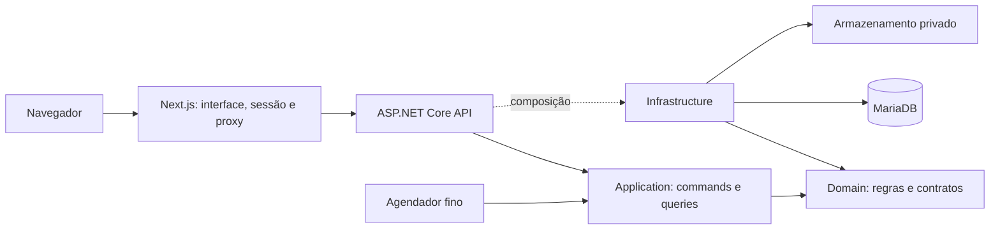

# Arquitetura e tecnologias

Referência principal: RevendaPRO. Foundation.Base autorizado e restore/build validados. Fundação, acesso e cadastros implementados; módulos financeiros abaixo ainda previstos. [Estado atual](../status/PROJECT_STATUS.md).

## Estrutura

Monólito modular com ASP.NET Core Minimal API e frontend Next.js separado. Minimal API foi definida explicitamente pelo usuário no [ADR-0002](decisions/ADR-0002-minimal-api-frontend-swagger.md); camadas e persistência seguem RevendaPRO. Um banco MariaDB compartilhado com isolamento por `IdTenant`. Tenant representa exatamente uma casa/assinatura. Contextos: Access, Households, Catalogs, Income, Accounts, Expenses, Cards, Budgets, Alerts, Reports e Subscriptions.

As setas entre camadas representam dependência; a execução utiliza interfaces resolvidas por DI. Sem microserviços, barramento ou event sourcing no escopo inicial. Separação de commands/queries usa o mesmo banco.

## Base técnica observada

| Componente | Referência local | Uso previsto |
|---|---|---|
| .NET | TargetFramework net10.0 | Backend |
| MediatR | 14.2.0 | Orquestração interna de casos de uso |
| FluentValidation | 12.1.1 | Validação de entrada |
| Foundation.Base | 3.2.0-rc.5 | Entity, UUID v7, auditoria, mapeamento e Dapper Unit of Work |
| EF Core | 10.0.5 | Migrations/mapeamentos, não leitura/escrita em runtime |
| MySql.EntityFrameworkCore | 10.0.1 | Provider de schema, com risco de compatibilidade MariaDB a testar |
| MySql.Data | 9.6.0 | Conexão/provider |
| Dapper | 2.1.79 | Toda leitura/escrita de negócio |
| MariaDB | imagem 11.8 | Persistência transacional |
| Next / React | 16.3.3 / 19.2.8 | App Router e interface |
| TypeScript / Tailwind | major 5 / 4 | Tipagem e estilo; patch será obtido do lockfile |
| Lucide React | faixa ^1.39.0 | Ícones |
| AWSSDK.S3 | 4.0.9 | Adaptador de arquivos na etapa de anexos |
| ClosedXML / QuestPDF | 0.104.2 / 2024.12.3 | Exportação; confirmar condição de uso comercial |
| xUnit / Moq | 2.9.3 / 4.20.72 | Unidade e comportamento |
| FluentAssertions / NetArchTest | 7.2.2 / 1.3.2 | Asserções e dependências |
| Testcontainers.MariaDb | 4.14.0 | Integração sobre provider real em ambiente isolado |

Versões são evidências dos arquivos locais, não alegação de versão mais recente ou compatibilidade já comprovada. Não atualizar NuGet. Na criação, fixar as versões validadas, centralizar em Directory.Packages.props e registrar hashes/lockfiles. Node e Docker serão conferidos nos Dockerfiles e ferramentas no marco M1.

## Persistência e transações

Repositories executam query objects em `Infrastructure/Queries/{Context}`. `IUnitOfWork` no Domain; implementação sobre Foundation Dapper na Infrastructure. Operações entre múltiplas tabelas usam uma única transação até o final: obter IDs gerados dentro dela, sem commit intermediário que exponha dados incompletos.

O código atual do RevendaPRO usa `DapperUnitOfWork`; seu ADR antigo descreve semântica anterior. O plano adota o padrão consolidado e exige teste do contrato efetivo do pacote (buffer de operações, IDs, rollback e concorrência). Não copiar exemplos de dois commits para uma liquidação financeira.

Dapper não aplica filtros globais do EF: toda leitura/escrita deve impor tenant e estado aplicável, incluindo JOINs. O código genérico do Foundation não prova isolamento; wrappers/contratos locais devem impedir acesso sem contexto da casa. Filtros de atividade não podem ocultar movimentos financeiros confirmados.

EF gera schema; aplicar migrations em etapa única controlada. O RevendaPRO documenta adaptação de `GET_LOCK` e execução de scripts para MariaDB; validar criação e atualização em banco vazio/populado antes de adotar. Falha de migration impede liberação, não autoriza recriar banco automaticamente.

## Sessão e autorização

Seguir RevendaPRO: route handlers do Next.js mantêm cookie HttpOnly e proxy `/api/backend/[...path]` injeta Bearer e preserva bytes de uploads/downloads. Evitar token no JavaScript. Sessões devem proteger mutações contra CSRF e validar origem. A documentação oficial orienta cookies protegidos e autorização próxima ao acesso a dados. [Next.js: autenticação](https://nextjs.org/docs/app/guides/authentication).

A API controla permissões de consulta/edição e vínculo com a casa. Políticas são aplicadas no endpoint e no caso de uso; guardas no menu não bastam. [ASP.NET Core: políticas](https://learn.microsoft.com/en-us/aspnet/core/security/authorization/policies?view=aspnetcore-10.0).

## Jobs e eventos

Proposta: hosted service fino para recorrências/alertas, com processamento em Application e controle de execução persistido por casa, chave única de ocorrência e lease recuperável. O modelo permite processo Worker separado futuramente sem mover regras. Não usar timer em memória como única garantia.

E-mail externo, quando configurado, usa outbox transacional, retentativa limitada e deduplicação. Alertas in-app são persistidos no mesmo banco. Falha de e-mail não perde alteração financeira. Cobrança automática é fase posterior e terá inbox para webhooks idempotentes.

## Cache

Começar sem Redis obrigatório. Dados financeiros oficiais vêm do banco; permissões devem respeitar revogação. Adicionar cache somente com necessidade medida e ADR. Chave deve conter ambiente, versão e casa; consultas dependentes de usuário incluem usuário/permissão; invalidar após commit. Idempotência financeira permanece no MariaDB.

## Independência e riscos técnicos

Infraestrutura, bancos, segredos, armazenamento e identidade visual próprios. Foundation.Base autorizado; feed e versão precisam funcionar em CI própria. O provider Oracle documenta suporte a EF/MySQL; isso não comprova MariaDB. [Matriz do Connector/NET](https://dev.mysql.com/doc/connector-net/en/connector-net-entityframework-core.html). O teste de compatibilidade em M1 é obrigatório antes de consolidar schema.

Registrar licenças e dependências transitivas, incluindo Argon2 na referência. Não adicionar NextAuth, Redis, AutoMapper ou ferramenta de gráfico apenas porque aparece em outro projeto. Para gráficos do dashboard, selecionar biblioteca após conferir requisitos de interação e licença; a escolha não muda a stack confirmada.
