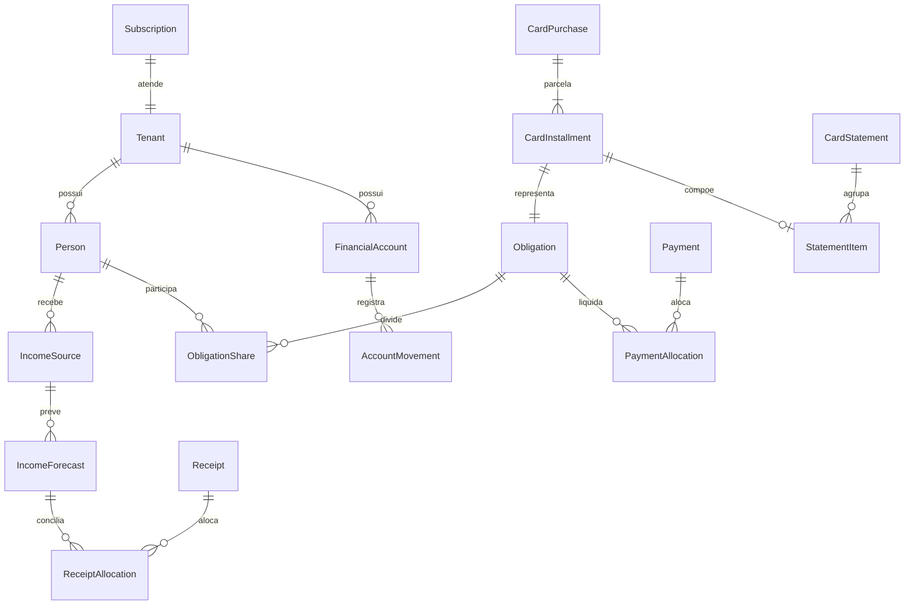

# Modelo conceitual de dados

Modelo proposto; não existe migration nesta entrega. Toda entidade persistida de negócio mantém Id, Code UUID v7, auditoria e tenant, conforme Foundation/RevendaPRO. Tabelas de plataforma têm escopo explícito separado. Pessoa não se confunde com identidade de login.

| Contexto | Entidades previstas | Relações e responsabilidades |
|---|---|---|
| Plataforma | Subscription, Tenant, Plan | Subscription ↔ Tenant 1:1; plano/limites configuráveis; piloto manual |
| Acesso | User, HouseholdMembership, Role, Permission, RolePermission, Invitation, RefreshToken | Identidade e vínculo com casa; papéis e permissão por operação |
| Casa | HouseholdSettings, Person | Person pertence a Tenant e pode vincular um membership |
| Catálogos | Category, IncomeType, ExpenseType, ExpenseTypeVersion, PaymentMethod, Creditor | Catálogos por casa; categoria pode ter pai |
| Campos | CustomFieldDefinition, CustomFieldValue | Tipo, restrição, opções e versão; valores validados e preservados |
| Renda | IncomeSource, IncomeSourceVersion, IncomeForecast, Receipt, ReceiptAllocation | Fonte gera previsões; alocação liga recebido à previsão |
| Conta | FinancialAccount, AccountMovement, Transfer, Reconciliation | Movimentos imutáveis/compensados; transferência tem duas pontas |
| Despesa | Obligation, InstallmentPlan, RecurringRule, Adjustment | Obrigação é unidade de vencimento; plano/regra gera obrigações |
| Liquidação | Payment, PaymentAllocation, Reversal | Pagamento sai de conta, aloca em obrigações e pode ser estornado |
| Rateio | ObligationShare, HouseholdContribution | Responsabilidade por pessoa e contribuição; sem duplicar despesa |
| Cartão | CreditCard, CardPurchase, CardInstallment, CardStatement, StatementItem, StatementPaymentAllocation | Compra→parcelas→fatura; parcelas referenciam obrigação única |
| Planejamento | Budget, BudgetLine, SavingsGoal, GoalAllocation | Limites mensais; metas vinculam recursos sem duplicar patrimônio |
| Alertas | AlertRule, AlertOccurrence, AlertState | Condição, deduplicação, leitura, adiamento e resolução |
| Arquivos | Attachment, ExportRequest | Metadados privados, estado, armazenamento e expiração |
| Operação | AuditEvent, IdempotencyRecord, JobExecution, OutboxMessage | Histórico, atomicidade de eventos e reprocessamento |

Entidades de metas/anexos/exportação pertencem a P1. Planos comerciais e inbox de pagamento externo entram em P2. O desenho definitivo deve evitar tabelas sem caso de uso implementado.

## Chaves, índices e restrições

- Code único; tenant imutável após criação; FKs com pertencimento validado.
- Índices iniciais `(IdTenant, DueDate)`, `(IdTenant, Competence)`, `(IdTenant, IdFinancialAccount, MovementDate)` e `(IdTenant, IdPerson, Competence)` conforme consultas.
- Unicidade de recorrência por casa/regra/data; idempotência por casa/operação/chave; fatura por casa/cartão/ciclo.
- Valor de alocações/rateios positivo ou zero apenas quando a regra permitir; soma validada transacionalmente.
- Version para concorrência otimista; operações de baixa também protegem leitura do saldo com transação/lock adequado.
- Não armazenar total de painel como fonte primária. Projeções/read models são reconstruíveis.
- Valores de campo adicional referenciam versão da definição. Campos estruturais financeiros ficam em colunas tipadas, não em JSON arbitrário.
- Sem cascade delete físico em histórico financeiro. Anonimização/expurgo são processos específicos da política de retenção.

## Invariantes entre agregados

Liquidação grava Payment, Allocation, Movement e AuditEvent na mesma transação. Recebimento segue o mesmo princípio. Fatura agrupa obrigações de cartão, mas não cria principal adicional. Conta não armazena saldo como único registro mutável: extrato deve permitir reconstrução e conciliação.

Ao pagar uma fatura, as alocações atingem suas obrigações subjacentes; somas de fatura, dívida aberta e extrato permanecem reconciliáveis. Definir ordem de alocação determinística e exibi-la, permitindo ajuste explícito quando necessário. Uma parcela só pertence a uma fatura ativa em cada instante.
